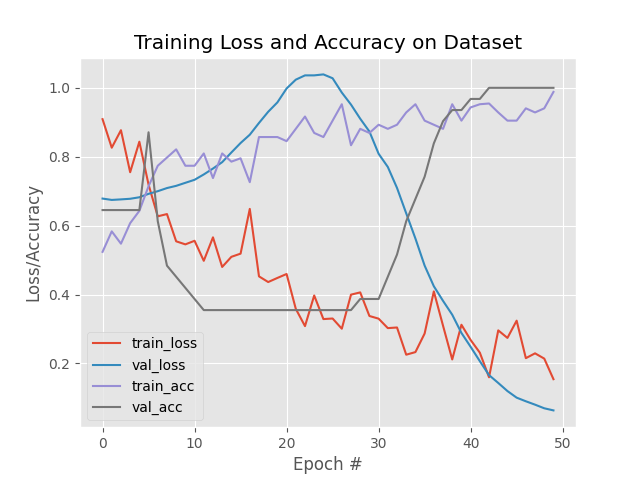

<h1 align="center">Cloud Liveness Detection</h1>
<p align="center">Login com senha, reconhecimento facial e detecção de vivacidade, para barrar quem tenta entrar com a foto de outra pessoa.</p>
<p align="center"><strong>Python 3.10</strong> · Streamlit · AWS Rekognition · TensorFlow/Keras · OpenCV</p>

<p align="center"></p>

Projeto de conclusão da disciplina de Cognitive Environments do MBA em Data Science e Inteligência Artificial da FIAP (2024), feito para a empresa fictícia QuantumFinance.

O setor de fraudes do banco recebeu reclamações de clientes que não reconhecem a contratação de crédito pessoal, embora cada operação tenha sido autenticada com a senha correta. A proposta é somar à senha uma selfie: o sistema confere se o rosto é o do titular e se é um rosto ao vivo, e não uma foto apontada para a câmera.

## Como funciona

1. **Senha.** Usuário e senha são conferidos numa base simulada, em `src/auth.py`.
2. **Selfie.** A foto vem da webcam pelo `st.camera_input` do Streamlit.
3. **Qualidade da foto.** O `DetectFaces` do AWS Rekognition analisa a imagem. A foto é recusada se tiver mais de um rosto, olhos fechados, óculos escuros ou rosto encoberto.
4. **Identidade.** O `CompareFaces` do Rekognition compara a selfie com a foto cadastrada do usuário. Se o rosto não corresponder, o login para aqui.
5. **Vivacidade.** Um detector SSD com ResNet-10 (Caffe, do OpenCV) localiza o rosto, que é recortado e reduzido para 32×32. O LivenessNet, uma CNN treinada para o projeto, classifica o recorte como `real` ou `fake`. Com `fake`, o acesso é negado e a confiança do modelo aparece na tela.

Só passa quem acerta a senha e as três verificações.

## Modelo de vivacidade

O dataset foi montado com vídeos e fotos separados em `real` e `fake`:

- `pre_processing/frame_converter.py` extrai cerca de seis quadros por segundo de cada vídeo e guarda só o rosto, recortado pelo mesmo detector SSD.
- `pre_processing/crop_images.py` faz o mesmo recorte nas fotos, depois de `clear_files_names.py` padronizar os nomes dos arquivos.

`src/liveness_model/train.py` treina o LivenessNet com cerca de 120 recortes:

| Parâmetro | Valor |
| --- | --- |
| Entrada | 32×32×3, normalizada entre 0 e 1 |
| Arquitetura | 2 blocos de Conv 3×3 (16 e 32 filtros) com BatchNorm, MaxPooling e Dropout, Dense 64 e softmax |
| Otimizador | Adam, taxa de aprendizado 1e-4 |
| Lote e épocas | 8 e 50 |
| Divisão | 75% treino, 25% validação |
| Aumento de dados | rotação, zoom, deslocamento, cisalhamento e espelhamento |

A acurácia de validação chega a 100% nas últimas épocas, como mostra o gráfico acima. Com cerca de 30 imagens de validação, vindas das mesmas pessoas e dos mesmos vídeos do treino, esse número é otimista.

O modelo treinado está em `src/liveness_model/model`, e o codificador de rótulos em `le.pickle`. O dataset não está no repositório.

## Instalar

Requer Python 3.10 e uma conta da AWS com acesso ao Rekognition. Na raiz do projeto:

```powershell
py -3.10 -m venv .venv
.\.venv\Scripts\Activate.ps1
pip install -r requirements.txt
```

Crie `.streamlit/secrets.toml` com as credenciais:

```toml
ACCESS_KEY = "sua-access-key"
ACCESS_SECRET = "sua-secret-key"
REGION = "us-east-1"
```

O arquivo já está no `.gitignore`. O `packages.txt` instala a `libgl1`, que o OpenCV exige no Streamlit Community Cloud.

## Usar

Na raiz do projeto, para que os caminhos relativos dos modelos funcionem:

```powershell
streamlit run src/app.py
```

A base simulada tem um único usuário, `default`, com senha `default`, cuja foto cadastrada é `db/default_user.png`. Para testar com o seu rosto, troque essa imagem por uma foto sua.

## Limitações

- Os usuários ficam numa lista fixa em `src/auth.py`, com a senha em texto puro. Num sistema real, viriam de um banco com senhas protegidas por hash.
- O detector e o LivenessNet são carregados do disco a cada login.
- O dataset é pequeno e pouco variado. O modelo tende a errar com iluminação, câmeras e pessoas diferentes das usadas no treino.

## Serviços externos e privacidade

Cada login envia a selfie duas vezes ao AWS Rekognition (`DetectFaces` e `CompareFaces`), junto com a foto cadastrada. As chamadas são cobradas pela AWS. A verificação de vivacidade roda localmente.

## Referências

- [Amazon Rekognition](https://docs.aws.amazon.com/rekognition/)
- [Liveness Detection with OpenCV](https://pyimagesearch.com/2019/03/11/liveness-detection-with-opencv/), do PyImageSearch, base da arquitetura LivenessNet
- [Enunciado de referência da FIAP](https://github.com/michelpf/fiap-ml-visao-computacional-detector-liveness)
